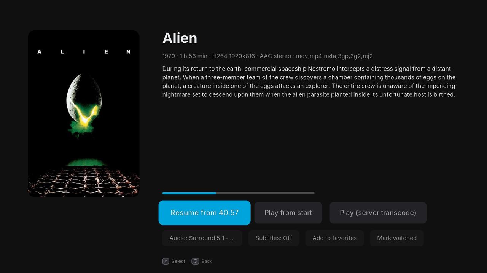

# Jellyfin for PS4 (unofficial)

A small native [Jellyfin](https://jellyfin.org) client for jailbroken PlayStation 4 consoles
running [GoldHEN](https://github.com/GoldHEN/GoldHEN), built with the
[OpenOrbis PS4 Toolchain](https://github.com/OpenOrbis/OpenOrbis-PS4-Toolchain).

This is an unofficial third-party client. It is not affiliated with the Jellyfin project or Sony.

 <!-- placeholder: add a screenshot here -->

## Features

- **Sign-in**
  - Servers on the local network are found automatically (Jellyfin's UDP discovery on port 7359). Servers in Docker with bridge networking usually can't answer it; enter the address manually then.
  - Server address entered with the PS4 system keyboard and checked before sign-in (shows the server's name and version).
  - "Who's watching?" picker with the server's public users and their avatars, plus "Other user".
  - Several users can stay signed in; "Switch user" on Home changes between them without passwords.
  - **Quick Connect** (approve a code from the Jellyfin web UI or app), or username and password.
  - The server address and username are remembered. The password is never stored; only the access token the server issues is saved.
  - If the server revokes the token, the app returns to sign-in with the server and username filled in.
- **Library**: Continue Watching, Next Up, Favorites, Movies, TV Shows, Collections and Genres as poster grids, plus series episode lists.
  - Detail pages show cast & crew (select a person for their filmography) and a "More like this" row.
  - Autoplay continues to the next movie in a collection, by the order the collection is sorted in.
  - Search with the system keyboard (movies, shows, episodes).
  - Sort Movies / TV Shows / genre and collection lists by name, year, date added or rating (□); jump by letter with L2 / R2.
  - Add / remove favorites and mark watched / unwatched from the details screen.
- **Playback**:
  - Direct play of the original file. Video is decoded on the console by FFmpeg (H.264, HEVC incl. 10-bit, MPEG-4, VP9, AV1; MP4/MKV/TS; AAC, AC3, E-AC3, MP3, FLAC, Opus…), so the server doesn't need to transcode.
  - Optional server transcode (H.264/AAC), used automatically if direct play fails.
  - Resume, and playback progress reported to the server (Continue Watching).
  - Audio and subtitle selection (details screen, or △ in the player). Embedded text and image (PGS/VobSub) subtitles are rendered in the app in direct play; external subtitles are fetched as SRT. Chosen languages are remembered per user, and per series (a TV show's choice overrides the global default for that show).
  - Next episode: a 10-second countdown at the end of an episode (× play now, ○ cancel).
  - Skip intro / recap / credits buttons from the server's media segments.
- **Settings** (OPTIONS on Home): direct play vs. always transcode, maximum transcode bitrate, default audio / subtitle language, subtitle size and position, autoplay next episode, audio output (Stereo or Multichannel PCM 5.1/7.1).
- **Player**: scrub-bar thumbnails (trickplay, when the server has generated them), chapter markers with chapter skip (L2 / R2), playback speed 0.5x–2.0x (▲ / ▼), and a playback-info overlay (□) showing direct play vs. transcode, codecs, resolution, bitrate, decode time and dropped frames.
- **Controls**: D-pad move, × select, ○ back. Player: × pause, ◀ ▶ 10 s, L1 / R1 1 min, ▲ / ▼ speed, L2 / R2 chapter, □ info, △ audio & subtitles, ○ stop.

## Requirements

- A PS4 or PS4 Pro with GoldHEN (Debug Settings enabled for the Package Installer).
- A Jellyfin server (10.10+ API; tested with a 12.x server) reachable over HTTP on your LAN.
  - **Quick Connect is recommended**: enable it in Dashboard → General → Quick Connect.
  - **Skip intro / credits** needs media segments on the server, e.g. from the [Intro Skipper](https://github.com/intro-skipper/intro-skipper) plugin. Without segments the button simply doesn't appear.
  - Direct play needs no server CPU. Transcoding is only a fallback and needs a server that can transcode in real time.

## Install

1. Build `jellyfin-ps4-<version>.pkg` yourself (see [Build](#build)); no prebuilt packages are provided.
2. Copy it to `/data/pkg/` on the console, e.g. with GoldHEN's FTP server (port 2121).
3. On the PS4: Settings → Debug Settings → Game → Package Installer → select the pkg.
   Newer versions install over older ones and keep your sign-in.
4. Start **Jellyfin for PS4**, enter your server address (e.g. `http://192.168.1.10:8096`) and sign in.

Files on the console: `/data/jellyfin/session.json` (server, username, access token, device id)
and `/data/jellyfin/log.txt` (diagnostic log; no passwords or tokens).
`tools/ps4_log.sh <ps4-ip>` prints the log over FTP.

## Build

Requirements: Docker (on Apple Silicon the amd64 image runs under emulation).

    ./build.sh          # -> build_ps4/jellyfin-ps4-<version>.pkg

- `tools/docker/Dockerfile`: Ubuntu 24.04, clang/lld 18, the OpenOrbis v0.5.4 release and libssl1.1 (for PkgTool.Core), all pinned by sha256.
- The first build compiles FFmpeg 7.1 and HarfBuzz 14.6.0 from their official source tarballs (`tools/build_ffmpeg_ps4.sh`, `tools/build_harfbuzz_ps4.sh`) into `ffmpeg_ps4/` and `harfbuzz_ps4/`.
- `tools/make_icon.py` renders `sce_sys/icon0.png`.
- Title ID `JFPS40001`, content ID `IV0000-JFPS40001_00-JFPS4UNOFFICIAL0` (see `Makefile.ps4`).

## Credits and licences

Jellyfin for PS4 is free software under the **GNU GPL v3** (see `LICENSE`).

The platform layer (Piglet with Sony's precompiled shaders, DualShock 4 input), renderer, FreeType text,
libSceHttp networking, the HTTP range reader, JSON, the FFmpeg player and the FFmpeg/HarfBuzz build
scripts are adapted from **[Stremio PS4](https://github.com/Navinas3460/Stremio-PS4)** (GPL-3.0).
The system keyboard set-up follows **[Apollo Save Tool](https://github.com/bucanero/apollo-ps4)** (GPL-3.0).

| Component | Use | Licence |
|---|---|---|
| [Stremio PS4](https://github.com/Navinas3460/Stremio-PS4) | adapted source (see above) | GPL-3.0 |
| [OpenOrbis PS4 Toolchain](https://github.com/OpenOrbis/OpenOrbis-PS4-Toolchain) | headers, library stubs, crt, `create-fself`, `PkgTool.Core`; `libc.prx`, `libSceFios2.prx`, `right.sprx` are packaged from it | GPL-3.0 (toolchain); see the toolchain for its bundled components |
| [FFmpeg](https://ffmpeg.org) 7.1 | video/audio decoding, statically linked (built without `--enable-gpl` / `--enable-nonfree`) | LGPL-2.1-or-later |
| [HarfBuzz](https://github.com/harfbuzz/harfbuzz) 14.6.0 | text shaping | MIT ("Old MIT") |
| [stb_image](https://github.com/nothings/stb) | poster decoding | MIT / public domain |
| [Inter](https://rsms.me/inter/) | UI font (`assets/fonts`) | SIL OFL 1.1 |
| FreeType, libSceHttp, Piglet, sceImeDialog… | Sony system libraries loaded from the console at run time (not distributed) | — |

"Jellyfin" is the name of the Jellyfin project; this client only talks to Jellyfin servers. The app icon is its own design and not the Jellyfin logo.
